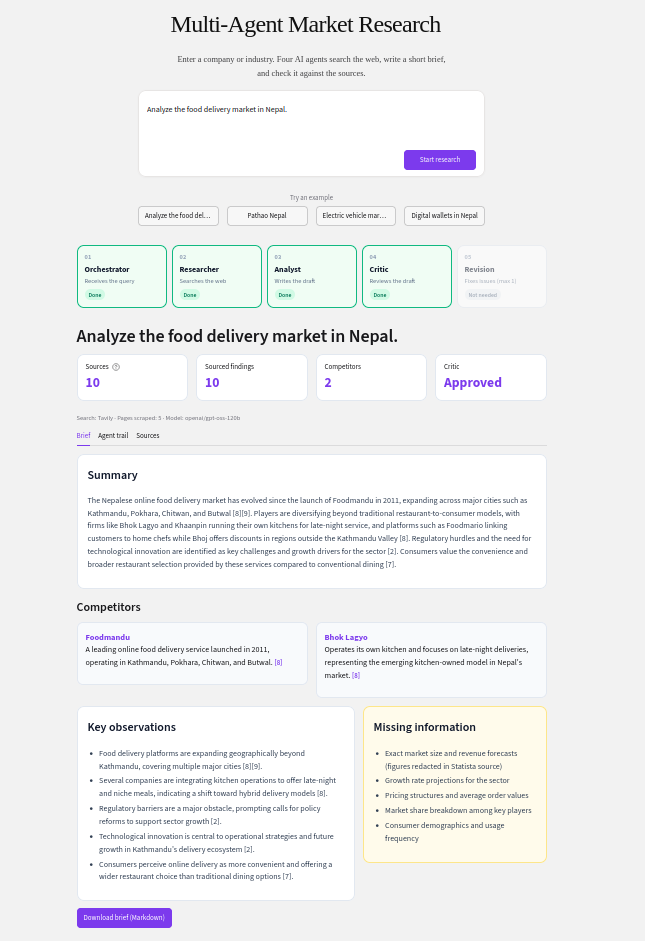

# Multi-Agent Market Research App

A Streamlit app that takes a company or industry (for example "Analyze the food delivery market in Nepal.") and produces a short research brief using four agents: Orchestrator, Researcher, Analyst and Critic.

See [sample_output.md](sample_output.md) for an example result.



Demo video:

https://github.com/user-attachments/assets/77e62530-634a-4dde-ab09-3a72c7b20363

## Requirements

- Python 3.10 or newer
- A Groq API key (free): https://console.groq.com/keys
- A Tavily API key (optional, free): https://app.tavily.com

Without a Tavily key the app uses DuckDuckGo search. If search fails completely, it uses the sample data in `sample_data/`, which is labelled as sample data in the app.

## Setup

Clone the repository:

```bash
git clone https://github.com/srijalMdr/multi-agent-market-research.git
cd multi-agent-market-research
```

Create a virtual environment and install the dependencies.

On macOS / Linux:

```bash
python3 -m venv .venv
source .venv/bin/activate
pip install -r requirements.txt
```

On Windows (PowerShell):

```powershell
python -m venv .venv
.venv\Scripts\Activate.ps1
pip install -r requirements.txt
```

Copy the example environment file and add your keys:

```bash
cp .env.example .env
```

On Windows use `copy .env.example .env`. Then open `.env` and replace `your_groq_api_key_here` with your Groq key. Replace the Tavily placeholder too if you have a key, otherwise leave it.

## Run

```bash
streamlit run app.py
```

Open http://localhost:8501, enter a company or industry and click "Start research". A run usually takes 20 to 60 seconds.

## Run the tests

The tests do not need API keys or internet access.

```bash
pip install -r requirements-dev.txt
pytest
```

## How it works

1. The Orchestrator receives the query and runs the other agents in order.
2. The Researcher searches the web, scrapes the main text of up to 5 pages, and extracts short facts, each linked to its source.
3. The Analyst writes the brief using only those facts: a summary, up to two competitors, key observations, sources and missing information.
4. The Critic checks the brief against the facts. If it finds problems, the Analyst revises the brief once.

The agents pass data to each other through a Pydantic model, `ResearchState`, defined in `core/models.py`. It holds the query, the research findings, the draft, the critic feedback and the final brief. The "Agent trail" tab in the app shows each step.

## Project structure

```
app.py             Streamlit interface
agents/            orchestrator, researcher, analyst, critic
core/models.py     shared Pydantic models
core/llm.py        LLM client
core/search.py     web search and sample data fallback
core/scraper.py    page scraping
core/report.py     brief to Markdown
sample_data/       sample data used when search fails
tests/             pytest tests
```

## Notes

- The free Groq tier has a limit of about 8,000 tokens per minute. If you run several searches in a row, the app may slow down while it waits and retries.
- Any OpenAI-compatible provider works. Change `LLM_BASE_URL`, `LLM_MODEL` and `LLM_API_KEY` in `.env`.
- If you get an error that the model is not available, set `LLM_MODEL` to a model your provider currently offers.
- `.env` is ignored by git. No API keys are included in this repository.
